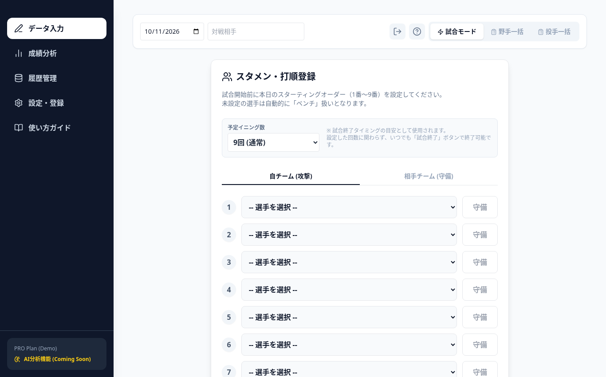
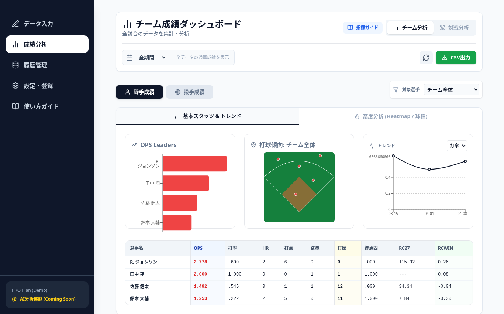

# IndieBall Stats Manager

独立リーグ球団向けの野球成績管理Webアプリ / A baseball stats manager for independent-league teams

**Live demo:** https://indiebaseball.vercel.app




---

## 日本語

### 解決したい課題
独立リーグ球団（和歌山ウェイブスでのインターン経験がきっかけ）では、専用のデータ分析スタッフや有料の分析システムがないことが多く、試合記録は紙やExcelでの手作業になりがちです。このアプリは、スマホ・PCのブラウザだけで試合の記録を入力し、その場で打撃・投手成績を集計できるようにすることを目的としています。

### できること（実装済みの機能）
- **データ入力（すべて手入力）**
  - **試合モード**: スタメン・打順を登録し、試合中に打席ごとの結果、走者状況、打球方向（グラウンド図をタップ）、一球ごとの球種・コース・球速などを記録
  - **野手一括 / 投手一括**: 試合後に1試合分の成績（打数・安打・四球…／投球回・被安打・奪三振…）をまとめて入力
  - 外部データの自動取り込みやAIによる入力機能はありません
- **成績の自動計算**: 打率・出塁率・長打率・OPS・BABIP・得点圏打率・RC27・RCWIN、投手の防御率・WHIP・FIP・QS率などを入力データから計算
- **ダッシュボード**: OPSランキング、打球方向図、成績推移グラフ、ヒートマップ・球種分析、対戦相手別の分析、期間・選手での絞り込み
- **履歴管理**: 入力した記録の一覧・編集・削除
- **データ出力**: 集計成績と記録ログのCSV出力、全データのJSONバックアップ／復元
- **指標ガイド・使い方ガイド**を画面内に用意

### 制限事項
- データはブラウザの **localStorage** にのみ保存されます（端末間の共有・同期はできません）。Firebase連携のコードは残っていますが現在は無効化されています。
- 初回起動時はサンプルの選手・試合データが表示されます。
- ログイン・権限管理はありません。

### 技術スタック
- React 19 / TypeScript 5.8 / Vite 6
- Recharts（グラフ）, lucide-react（アイコン）
- Tailwind CSS（CDN経由）
- firebase パッケージ（依存関係にあるが現在は未使用）
- ホスティング: Vercel

### ローカルで動かす
```bash
npm install
npm run dev      # http://localhost:3000
npm run build    # 本番ビルド（dist/）
```
APIキーなどの設定は不要です。

---

## English

### Problem
Independent-league baseball teams in Japan (this project grew out of my internship with the Wakayama Waves) usually have no dedicated analysts or paid analytics tools, so game records are kept by hand on paper or in Excel. This app lets staff record games from a phone or laptop browser and see batting/pitching stats immediately.

### Features (as implemented)
- **Data entry (all manual)**
  - **Live game mode**: set the lineup, then log each plate appearance (result, base runners, batted-ball location by tapping a field diagram) and individual pitches (type, location zone, velocity, result)
  - **Batch mode** for batters and pitchers: enter a whole game's box-score line after the game
  - There is no automatic import from external sources and no AI-based entry
- **Automatic stat calculation**: AVG, OBP, SLG, OPS, BABIP, RISP AVG, RC27, RCWIN; ERA, WHIP, FIP, QS rate, etc.
- **Dashboard**: OPS leaders, spray chart, trend chart, heatmap / pitch-type analysis, per-opponent view, filters by period and player
- **History**: list, edit and delete records
- **Export**: CSV export of stats and raw logs; full JSON backup / restore
- In-app metrics glossary and user guide (Japanese)

### Limitations
- Data is stored only in the browser's **localStorage** (no sync between devices). Firebase sync code exists but is disabled.
- Sample players and games are loaded on first launch.
- No authentication or roles.

### Tech stack
React 19, TypeScript 5.8, Vite 6, Recharts, lucide-react, Tailwind CSS (CDN). Deployed on Vercel.

### Run locally
```bash
npm install
npm run dev      # http://localhost:3000
npm run build
```
No API keys are required.
